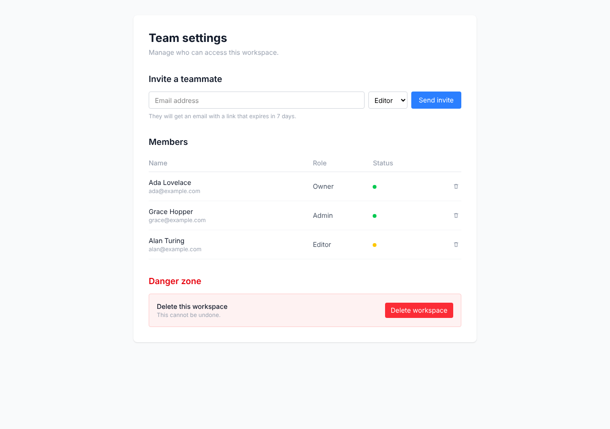
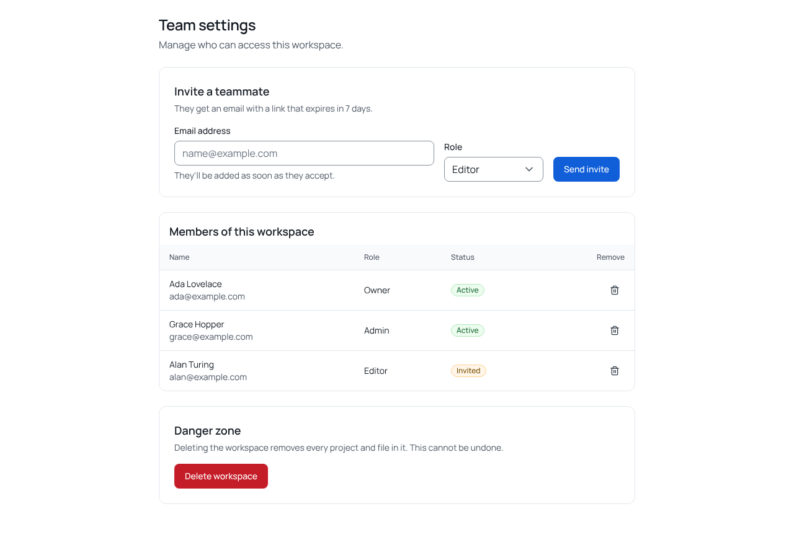

# Before and after: the same page, with and without the system

The prompt given to both pages, word for word:

  Build a Team settings page for a workspace app. It needs:
  - a form to invite a teammate by email, with a role picker and a Send invite button
  - a table of current members showing name, email, role and status
  - a way to remove a member from the table
  - a danger zone that deletes the whole workspace, behind a confirmation

One page was written with no design system: plain Tailwind, the way a model answers that
prompt in a fresh project. The other was built from Keel, with AGENTS.md and the rule files
in context. Nothing else differs — same brief, same content, same screen.

Generated by `npm run compare`. Both pages are measured by the same probes that gate every
pull request (`scripts/lib/ui-probe.mjs`) and the same `npm run audit`, in the same browser,
on the same screen. The difference in these numbers is the system, not the measurement.

## The two pages

| Without the system | With Keel |
| --- | --- |
|  |  |

Both look reasonable at a glance on a laptop. That is the point: the difference is not taste,
it is what happens when you press Tab, shrink the window, or read it with a screen reader.

## Results

| | Without the system | With Keel |
| --- | --- | --- |
| Audit findings | 35 | 0 |
| Rules broken | palette-class, off-scale, opacity-fade | none |
| axe violations (WCAG 2.2 A/AA) | 15 | 0 |
| Keyboard stops with no usable focus ring | 7 of 7 | 0 of 7 |
| Targets under 24px and crowded | 0 | 0 |
| Widths that scroll sideways | 320px, 375px | none |

## What the audit found in the page without a system

35 findings across palette-class, off-scale, opacity-fade. Run `npm run audit -- experiments/pages/WithoutKeel.tsx` for every line and its fix.

## What a browser found in the page without a system

**Accessibility violations**

- **button-name** (critical) — 3 elements: `.border-gray-100:nth-child(1) > .text-right > .p-1.hover\:bg-gray-100 | .border-gray-100:nth-child(2) > .text-right > .p-1.hover\:bg-gray-100 | .border-gray-100:nth-child(3) > .text-right > .p-1.hover\:bg-gray-100`
- **color-contrast** (serious) — 11 elements: `p:nth-child(2) | .bg-blue-500 | .-mt-6`
- **select-name** (critical) — 1 element: `select`

**Focus**

- no visible focus ring on Email address <input>
- no visible focus ring on EditorAdminOwner <select>
- no visible focus ring on Send invite <button>
- no visible focus ring on BUTTON <button>
- no visible focus ring on BUTTON <button>
- no visible focus ring on BUTTON <button>
- no visible focus ring on Delete workspace <button>

**Target size**

- no target under 24px is crowded

**Reflow**

- at a 320px viewport the page is 752px wide, so it scrolls sideways
- at a 375px viewport the page is 752px wide, so it scrolls sideways

## The same checks on the Keel page

**Accessibility violations**

- none

**Focus**

- all 7 keyboard stops show a ring at least 2px wide with 3:1 contrast

**Target size**

- no target under 24px is crowded

**Reflow**

- no sideways scrolling at 320 or 375px

## Honest notes

- The page without a system is not a strawman. It uses real buttons, a real table and a real
  dialog, and it looks fine at a glance on a laptop. Every problem the checks found is one a
  design system exists to prevent, not one planted to lose the comparison.
- The same model wrote both pages. The difference is what was in context: `AGENTS.md`, the
  rule files and the components, versus nothing.
- The Keel page is longer to write and imports more. That is the trade: the rules are in the
  components instead of in your head.
- The first run of this comparison failed the Keel page on reflow, and it was right to. The page
  put a Table straight into a flex column without `min-w-0`, which rule 8 of
  [the table rules](rules/table.md) exists to prevent, so the table could not shrink and the page
  scrolled sideways on a phone. Having the rule written down did not stop the mistake being made;
  the check is what caught it. Both are the system doing its job.
